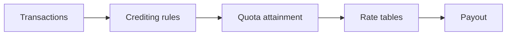

import Chart from '../../components/embeds/Chart.astro';
import CommissionCalculator from '../../components/embeds/CommissionCalculator.astro';
import Callout from '../../components/embeds/Callout.astro';

This post is a **draft**. It shows up when you run the site locally, but it is never published. Use it as a reference for what a post can contain.

## Text

Regular paragraphs, **bold**, *italic*, [links](https://example.com), and `inline code`. Long-form text is capped at a comfortable line length so it stays easy to read.

> A blockquote looks like this. Use it for quotations or a line you want to stand apart.

- Bulleted lists
- with several items
  - and nesting

1. Numbered lists
2. work too

## Code

```ts
// Every code block gets syntax highlighting and a Copy button.
function commission(sales: number, quota: number, base = 0.04, accel = 0.07) {
  return Math.min(sales, quota) * base + Math.max(0, sales - quota) * accel;
}
```

```sql
SELECT rep_id, SUM(amount) AS credited
FROM credits
WHERE period = '2026-Q3'
GROUP BY rep_id;
```

## Diagram

Write a `mermaid` code block and it renders as a diagram that follows light and dark mode:



## Chart

<Chart
  title="Payout by quarter ($k)"
  type="bar"
  labels={['Q1', 'Q2', 'Q3', 'Q4']}
  series={[
    { name: '2025', values: [120, 180, 150, 220] },
    { name: '2026', values: [140, 175, 190, 260] },
  ]}
  unit="k"
/>

<Chart
  title="Attainment trend (%)"
  type="line"
  labels={['Jan', 'Feb', 'Mar', 'Apr', 'May', 'Jun']}
  series={[{ name: 'Team', values: [62, 71, 88, 94, 103, 110] }]}
  unit="%"
/>

## Interactive calculator

<CommissionCalculator target={500000} baseRate={4} accelRate={7} />

## Callout

<Callout title="Note">
  Callouts highlight an aside without breaking the flow of the post.
</Callout>

## Table

| Tier | Attainment | Rate |
| --- | --- | --- |
| 1 | 0–100% | 4% |
| 2 | 100%+ | 7% |
